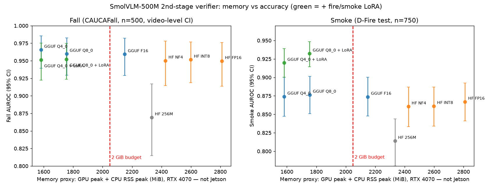

# 엣지 VLM 2차 검증기를 2GB 안에 넣기: 양자화보다 런타임이 먼저였다

> SmolVLM-500M을 2차 검증기(낙상·화재·연기)로 쓸 때, **정확도를 지키면서 메모리를 2GB 이하로 줄이는 조건**을 찾은 실험입니다.
> 판단의 경위는 [`DECISIONS.md`](DECISIONS.md), 전체 수치는 [`results/summary.md`](results/summary.md)에 있습니다.

## 1. 문제

- 이전 회사에서 Jetson Orin NX 8GB(CPU·GPU 공유 메모리)에 1차 CNN 검출기와 2차 VLM 검증기(SmolVLM-500M, PyTorch FP16)를 함께 올렸다.
- 다른 프로세스를 빼고 남는 메모리가 약 2GB였다. 그래서 VLM을 상시 구동하지 못하고 이벤트가 생길 때만 띄웠다.
- 질문: **"VLM을 얼마나, 어떻게 줄이면 2GB 안에서 상시 구동할 수 있는가? 그 대가로 정확도는 얼마나 잃는가?"**

## 2. 결론



| | 메모리 대리 합계 | 낙상 AUROC | 불꽃 AUROC | 기준 대비 판정 뒤집힘 |
|---|---|---|---|---|
| PyTorch FP16 (회사 운영 방식) | 2,810MB | 0.950 | 0.971 | — |
| PyTorch NF4 (4bit) | 2,426MB | 0.950 | 0.968 | 2.6~5.3% |
| SmolVLM-256M FP16 (작은 모델) | 2,334MB | **0.869** | 0.946 | 13~27% |
| llama.cpp F16 | 2,150MB | 0.959 | 0.974 | (HF와 전처리가 다름) |
| **llama.cpp Q8_0** | **1,755MB** | 0.960 | 0.976 | 0.6~0.8% |
| llama.cpp Q8_0 + 비전 Q8_0 | 1,650MB | 0.961 | 0.976 | 0.7~1.6% |
| **llama.cpp Q8_0 + 불꽃·연기 LoRA** | **1,754MB** | 0.952 | **0.994** | 0.2~1.1% (LoRA F16 대비) · 연기 AUROC 0.876 → **0.932** |

1. **2GB를 막은 것은 가중치가 아니라 런타임이었다.** PyTorch 경로는 4bit로 줄여도 2.3GB 아래로 내려가지 않았다. CPU 메모리가 모델 크기와 상관없이 약 1.5GB로 고정이기 때문이다. 같은 FP16이라도 llama.cpp로 바꾸면 660MB가 줄었다.
2. **양자화는 판별력(AUROC)을 거의 건드리지 않았다.** 반면 작은 모델(256M)은 쪼그려 앉기의 54%를 쓰러짐으로 판정했다. 메모리를 줄여야 한다면 작은 모델보다 큰 모델을 양자화하는 쪽이 낫다.
3. **다만 점수 보정은 달라진다.** threshold를 고정(0.55)하면 4bit에서 recall이 6~10%p 움직인다. 재보정이 필요한데, 사람이 바뀌는 효과(같은 모델에서 FPR 0.016 vs 0.120)가 양자화 효과보다 컸다. 그래서 **재보정은 현장 데이터로 해야 한다.**
4. **현장 차이의 정체는 상당 부분 주간·야간(IR)이었다.** 흑백 영상의 오탐률은 0.220, 컬러는 0.030이었다(FP16, t=0.55). 다른 사람의 보정 데이터를 늘려도 낙상은 23~29%의 경우에서 목표 오탐률의 2배를 넘었다. 같은 분포인 화재는 음성 50~100장이면 충분했다. → threshold는 **같은 카메라에서, 주간·야간을 나눠** 정해야 한다(흑백 참가자가 2명뿐이라 가설 수준).
5. **모델 자체의 약점은 LoRA로 고치고, 고친 모델도 Q8_0을 견뎠다.** 작은 연기 AUROC가 0.51 → 0.84, 불꽃 프롬프트가 연기에 속는 비율이 21% → 4%로 줄었다(GGUF Q8_0 기준). LoRA F16 대비 판정 뒤집힘은 0.2~1.1%이고 메모리는 그대로다. 단, 낙상 점수가 아래로 이동해(t=0.55 recall 0.80 → 0.63, AUROC는 유지) 낙상 threshold를 다시 정해야 하고, 개선 폭의 상당 부분은 학습 분할과 같은 카메라가 있는 AoF에서 나왔다.
6. 권고: **llama.cpp + LoRA 병합 Q8_0** (대리 지표 1,754MB), `--cache-ram 0`, `CUDA_MODULE_LOADING=LAZY`, 현장·주야간별 threshold 재보정

## 3. 어떻게 확인했나

| 항목 | 내용 |
|---|---|
| 데이터 | 낙상: [CAUCAFall](https://data.mendeley.com/datasets/7w7fccy7ky) (CC BY 4.0) 영상 100개·참가자 10명에서 500장. 양성은 falling 100 / collapsed 150, 음성은 줍기·무릎 꿇기·앉기 150 / 걷기·뛰기 100<br>화재: [D-Fire](https://github.com/gaiasd/DFireDataset) 테스트 분할에서 854장 (불꽃만 104 / 연기만 250 / 둘 다 250 / 없음 250) |
| 입력 | 낙상은 사람 bbox를 2배로 넓힌 크롭(1차 검출기 크롭 흉내 + 바닥 맥락 유지). 화재는 전체 이미지. 긴 변 512px |
| 점수 | 마지막 토큰의 `" Yes"`/`" No"` 확률 비율 (회사 운영 레시피와 같음) |
| LoRA | D-Fire **학습 분할**만 사용, 평가 이미지와 번호 인접(±20)·동일 바이트 제외, 번호 블록 단위 검증 세트로 체크포인트 선택, 답 토큰에만 loss, 언어 모델만(8.68M). 평가셋은 마지막에 한 번만 사용 |
| 레시피 검증 | 회사 이미지 25장으로 다시 채점했을 때 이전 기록과 차이 0.00000 (이전 기록은 Jetson 운영 점수와 차이 0.0009). 회사 이미지는 공개하지 않음 |
| 지표 | AUROC(주 지표, threshold 무관), t=0.55 판정(운영값), 기준 대비 판정 뒤집힘. 낙상 신뢰구간은 **영상 단위** 부트스트랩 |
| 메모리 | Jetson 공유 메모리의 대리 지표 = 프로세스 GPU 최대 + CPU RSS 최대 (0.2초 간격 샘플링) |
| 환경 | RTX 4070 SUPER, batch 1, 워밍업 3회, torch 2.13 / transformers 5.19 / bitsandbytes 0.50.2 / llama.cpp b11770 (CUDA 12.8) |
| 바꾼 변수 | 같은 이미지, 같은 프롬프트에서 정밀도 또는 런타임 하나만 바꿈 |

## 4. 해보고 뺀 것 (일부)

| 시도 | 뺀 이유 |
|---|---|
| bbox 가로세로 비율로 넘어짐 판별 | 카메라 쪽으로 넘어지면 누워 있어도 bbox가 세로로 길다 |
| D-Fire 중복 제거에 지각 해시 사용 | 야간 고정 카메라에서 다른 장면을 중복으로 판정했다 |
| GGUF Q4_K_M을 4bit로 보고 | hidden 960이 256으로 나누어떨어지지 않아 실제로는 5.89 BPW였다 → Q4_0 추가 |
| llama-server 기본 설정 | 프롬프트 캐시가 RAM을 최대 8GB까지 쓴다(RSS 9.4GB 관측) |
| "CPU에 가중치 사본이 남는다" 가설 | 로드 직후 RSS 증가량이 가중치보다 훨씬 작았다. RSS는 CUDA 모듈 로딩 방식에 좌우된다 (EAGER로 바꾸면 RSS 최대값이 PyTorch 5.7GB, llama.cpp 2.4GB) |

전체 목록과 이유는 [`DECISIONS.md` 4절](DECISIONS.md)에 있습니다.

## 5. 한계 (면접에서 먼저 말할 것)

- **Jetson에서 잰 값이 아니다.** 메모리는 x86 데스크톱에서 잰 대리 지표이고, 지연도 데스크톱 GPU 수치다.
- llama.cpp는 SmolVLM 이미지를 **항상 두 번**(overview + 타일) 넣는다. HF 레시피와 전처리가 다르다. 회사 이미지 25장에서는 이 차이 때문에 양성·음성 점수 간격이 0.231에서 0.028로 줄었다.
- CAUCAFall은 실내 1곳·참가자 10명이고, D-Fire 화재는 원거리 야외 장면이 많다. 회사 도메인(창고·로딩 도크)과 다르다.
- 작은 연기(박스 면적 1% 미만)는 모든 설정에서 AUROC 0.5 수준이다. 양자화와 상관없는 모델의 한계다.
- falling 그룹은 데이터셋 라벨 정의상 "넘어지는 중"이 아니라 "착지 직후 0.35초"다.
- LoRA의 연기 개선 폭 중 상당 부분은 AoF(학습 분할과 같은 고정 카메라가 있을 수 있음)에서 나왔다. 처음 보는 카메라에서는 더 작을 수 있다.

## 6. 재현

```bash
# 데이터 (이미지는 재배포하지 않음)
python scripts/download_caucafall.py labels
python scripts/build_fall_set.py && python scripts/download_caucafall.py frames data/fall/frame_list.txt
python scripts/make_crops.py
bash scripts/download_dfire.sh && python scripts/build_fire_set.py
# 실행
bash scripts/run_all.sh        # PyTorch: fp16 / fullframe / 256m / bnb8 / bnb4 / bnb8_all  (+ --config bnb4_all)
bash scripts/run_all_gguf.sh   # llama.cpp: third_party/에 b11770 ubuntu-cuda-12.8 배포판, data/gguf/에 모델
# LoRA (third_party/llama-src에 39da130fc 소스 필요)
bash scripts/download_dfire_train.sh && python scripts/build_lora_data.py && python scripts/train_lora.py
python scripts/run_eval.py --config lora_fp16 && python scripts/export_lora_gguf.py
for c in gguf_lora_f16 gguf_lora_q8_0 gguf_lora_q4_0; do python scripts/run_gguf.py --config $c; done
python scripts/metrics.py && (cd scripts && python recalibrate.py && python calib_size.py) && python scripts/make_figure.py
```
버전은 `requirements-lock.txt`에 고정되어 있습니다.

## 7. AI 사용 범위  ✏️ (본인이 다듬을 것)

- 코드 작성과 실행은 Claude Code가 했다. 문제 정의, 양성 정의(falling/collapsed), 입력 방식, 불꽃·연기 분리, 비교 대상(256M), 런타임 범위는 직접 정했다 (`DECISIONS.md` D-01~D-11).
- 이후 세부 판단은 Claude가 정하고 근거를 기록했다(`[Claude 판단]` 표시). 직접 검토한 항목: _(작성)_
- AI가 만든 코드에서 발견하고 고친 문제: bitsandbytes skip 패턴 버그(D-19), 재보정 규칙(D-23) _(직접 고친 부분이 있으면 추가)_
