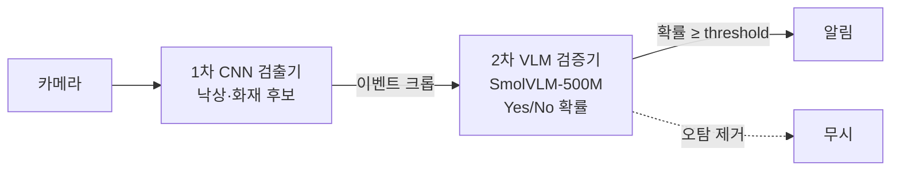

# edge-vlm-verifier-2gb

**엣지 VLM 2차 검증기를 2GB 안에 넣기 — 막고 있던 것은 양자화가 아니라 런타임이었다**

*Fitting a SmolVLM-500M fall/fire/smoke verifier into a 2 GB edge memory budget. Quantization barely mattered; the runtime did (PyTorch 2.8 GB → llama.cpp Q8_0 1.75 GB, desktop proxy).*

> **요약**
> - **문제:** Jetson 8GB에서 VLM 2차 검증기에 쓸 수 있는 메모리는 약 2GB였다. 이 안에서 상시 구동이 가능한가?
> - **발견:** PyTorch는 4bit로 줄여도 2.3GB 아래로 내려가지 않았다. CPU 메모리 약 1.5GB가 모델 크기와 상관없이 고정이었다(CUDA 모듈 로딩). 런타임을 llama.cpp로 바꾸고 Q8_0으로 양자화하니 **1,754MB**가 됐고, 정확도는 유지됐다.
> - **그다음 문제:** 정확도를 흔드는 것은 양자화가 아니라 **현장 차이(주간·야간)**였다. 모델 자체의 약점(작은 연기)은 LoRA로 고쳤고, 고친 모델도 Q8_0을 견뎠다.
>
> 메모리는 RTX 4070 데스크톱에서 잰 **대리 지표**(GPU 프로세스 최대 + CPU RSS 최대)이며, Jetson 실측이 아닙니다.

---

## 문제

<!-- ✏️ 본인 말로 다듬을 부분: 현장에서 겪은 상황, 이벤트 트리거 방식의 불편함 -->

이전 회사에서 영상보안 엣지 장비(Jetson Orin NX 8GB, CPU·GPU 공유 메모리)에 2단계 판정 구조를 올렸다.



1차 검출기와 다른 프로세스를 빼면 VLM에 쓸 수 있는 메모리는 약 2GB였다. 하지만 PyTorch FP16 VLM은 이를 넘어서, **상시 구동 대신 이벤트가 생길 때만 띄우는 방식**으로 운영했다.

> **질문:** VLM을 얼마나, 어떻게 줄이면 2GB 안에서 상시 구동할 수 있는가? 그 대가로 정확도는 얼마나 잃는가?

## 결과


| 설정 | 메모리 (대리 지표) | 낙상 AUROC | 불꽃 AUROC | 연기 AUROC |
|---|---|---|---|---|
| PyTorch FP16 (회사 운영 방식) | 2,810MB | 0.950 | 0.971 | 0.867 |
| PyTorch 4bit (NF4) | 2,426MB | 0.950 | 0.968 | 0.861 |
| 작은 모델 (SmolVLM-256M FP16) | 2,334MB | 0.869 | 0.946 | 0.814 |
| llama.cpp Q8_0 | 1,755MB | 0.960 | 0.976 | 0.876 |
| **llama.cpp Q8_0 + 불꽃·연기 LoRA** | **1,754MB** | **0.952** | **0.994** | **0.932** |

**핵심 발견 3가지**
1. **메모리를 막은 것은 런타임이었다.** 같은 FP16이라도 PyTorch → llama.cpp로 바꾸면 660MB가 줄었다. 4bit 양자화로 줄어든 양(384MB)보다 크다.
2. **8bit 양자화는 정확도를 지킨다. 작은 모델은 그렇지 못하다.** Q8_0은 판정이 0.6~0.8%만 바뀌었다. 256M 모델은 쪼그려 앉기의 54%를 쓰러짐으로 판정했다. → 메모리를 줄여야 한다면 큰 모델을 양자화하는 편이 낫다.
3. **정확도를 흔드는 것은 현장 차이였다.** 흑백(IR) 영상의 낙상 오탐률은 0.220, 컬러는 0.030이었다. 양자화로 생긴 차이보다 훨씬 크다. → threshold는 **같은 카메라에서, 주간·야간을 나눠** 정해야 한다.

**권고 구성:** llama.cpp + LoRA 병합 SmolVLM-500M Q8_0, `--cache-ram 0`, `CUDA_MODULE_LOADING=LAZY`, 과제·현장·주야간별 threshold

<details>
<summary>전체 결과 표 (bitsandbytes INT8, GGUF Q4_0, 비전 Q8 등 14개 설정)</summary>

[`results/summary.md`](results/summary.md)에 모든 설정의 정확도, 메모리 분해, 지연, 판정 뒤집힘, 그룹별·출처별 결과가 있다.
</details>

## 판단의 흐름

결과보다 **가설이 어떻게 바뀌었는지**가 이 프로젝트의 핵심이다. 판단마다의 근거는 [`DECISIONS.md`](DECISIONS.md)(D-01~D-26)에 있다.

| 단계 | 가설 / 시도 | 측정 결과 | 다음 판단 |
|---|---|---|---|
| 1 | 양자화하면 2GB에 들어갈 것이다 | PyTorch 4bit도 2,426MB | 왜 안 줄어드는지 메모리를 분해해서 측정 |
| 2 | CPU에 가중치 사본이 남아 있을 것이다 | ✗ 로드 직후 증가량은 가중치보다 훨씬 작음. 256M도 RSS 1.5GB로 같음 | 모델이 아니라 런타임 비용 → `CUDA_MODULE_LOADING=EAGER`로 확인하니 RSS가 1.5GB → 5.7GB |
| 3 | 가벼운 런타임(llama.cpp)이면 줄어들 것이다 | F16 2,150MB, Q8_0 1,755MB ✓ | 기본값의 함정 3개를 찾아 처리 (아래) |
| 4 | 양자화가 정확도를 떨어뜨릴 것이다 | Q8_0 판정 뒤집힘 0.6~0.8%. 4bit는 순위는 지키지만 점수 보정이 움직임 | threshold 재보정이 필요한지, 얼마나 필요한지 측정 |
| 5 | 보정 데이터를 늘리면 해결될 것이다 | 화재는 음성 50~100장이면 충분. **낙상은 다른 사람 데이터로는 안 됨** | 참가자별로 분해 → 흑백(IR) 영상이 원인 |
| 6 | 모델의 약점(작은 연기 AUROC 0.51)은 양자화와 무관하다 | LoRA로 0.84, Q8_0 후에도 유지 | LoRA 뒤 낙상 점수가 내려감 → 재학습 대신 threshold 재보정으로 해결됨을 확인 |

**llama.cpp 기본값의 함정** (그대로 배포했다면 놓쳤을 것)
- 프롬프트 캐시가 RAM을 최대 8GB까지 씀 (실제로 RSS 9.4GB 관측) → `--cache-ram 0`
- SmolVLM 이미지를 **항상 두 번** 넣음(overview + 타일). 큰 이미지는 여러 타일로 쪼개짐 → 긴 변을 512px로 미리 줄이고, 비교 기준을 런타임별로 분리
- `Q4_K_M`은 hidden 960이 256으로 나누어떨어지지 않아 실제로는 5.89비트 → 진짜 4bit인 `Q4_0` 추가

## 어떻게 확인했나

**데이터.** 회사 데이터는 공개할 수 없고 25장뿐이라 공개 데이터셋으로 다시 만들었다. 이미지는 재배포하지 않고 다운로드 스크립트만 제공한다.

| 과제 | 데이터셋 (라이선스) | 평가셋 |
|---|---|---|
| 낙상 | [CAUCAFall](https://data.mendeley.com/datasets/7w7fccy7ky) (CC BY 4.0) — 실내, 참가자 10명, 주간·야간 | 500장 (영상 100개). 양성: 착지 직후 100 / 누운 상태 150. 음성: 줍기·무릎 꿇기·앉기 150 / 걷기·뛰기 100 |
| 불꽃·연기 | [D-Fire](https://github.com/gaiasd/DFireDataset) (CC0, 일부 원 출처 약관) — 감시카메라·웹 수집 | 테스트 분할에서 854장 (불꽃만 104 / 연기만 250 / 둘 다 250 / 없음 250) |

**측정 원칙**
- **바꾼 변수는 하나씩:** 같은 이미지, 같은 프롬프트에서 정밀도나 런타임 하나만 바꿨다.
- **레시피 재현:** 회사 이미지 25장을 다시 채점하니 이전 기록과 점수 차이가 0.00000이었다. 이전 기록은 Jetson 운영 점수와 차이 0.0009였다. 회사 이미지는 공개하지 않는다.
- **입력:** 낙상은 사람 bbox를 2배로 넓혀 자른다(1차 검출기 크롭 + 바닥 맥락). 화재는 전체 이미지, 긴 변 512px.
- **지표:** AUROC(threshold와 무관), 운영값 t=0.55에서의 판정, 기준 대비 판정 뒤집힘 비율.
- **신뢰구간:** 낙상은 영상 단위 부트스트랩(같은 영상의 프레임은 서로 비슷함), 1000회.
- **자동 검사:** 양자화가 의도한 범위에만 적용됐는지 모듈 수로 확인하고, 다르면 실행을 멈춘다(실제로 버그를 한 번 잡았다).
- **LoRA:** 학습 분할만 사용(평가 이미지와 번호가 인접한 이미지 제외), 별도 검증 세트로 체크포인트 선택, 답 토큰에만 loss, 평가셋은 마지막에 한 번만 사용.
- **환경:** RTX 4070 SUPER, batch 1, 워밍업 3회. torch 2.13 / transformers 5.19 / bitsandbytes 0.50.2 / llama.cpp b11770 (CUDA 12.8)

## 해보고 뺀 것

| 시도 | 뺀 이유 |
|---|---|
| bbox 가로세로 비율로 넘어짐 판별 | 카메라 쪽으로 넘어지면 누워 있어도 bbox가 세로로 길다 |
| D-Fire 중복 제거에 지각 해시 사용 | 야간 고정 카메라에서 다른 장면을 중복으로 판정했다 |
| 작은 모델(256M)로 2GB 맞추기 | 정확도가 크게 떨어지고, 런타임 비용 때문에 메모리도 2GB를 넘는다 |
| PyTorch 경로로 2GB 맞추기 | 가장 작은 설정(4bit + 비전 4bit)도 2,310MB다 |
| 낙상 데이터를 섞어 LoRA 재학습 | threshold 재보정만으로 recall이 원래 수준(FPR 5%에서 0.776)으로 돌아왔다 |

전체 목록은 [`DECISIONS.md` 4절](DECISIONS.md)에 있다.

## 한계와 다음 단계

**한계**
- **Jetson에서 잰 값이 아니다.** 메모리는 x86 데스크톱의 대리 지표이고, 지연도 데스크톱 GPU 수치다.
- llama.cpp는 HF와 전처리가 다르다(이미지 2번 입력). 회사 이미지 25장에서는 이 때문에 양성·음성 점수 간격이 0.231에서 0.028로 줄었다. 배포 전에 현장 데이터로 다시 확인해야 한다.
- CAUCAFall은 실내 1곳·참가자 10명이고, 흑백(IR) 참가자는 2명뿐이라 주간·야간 효과는 가설 수준이다. D-Fire의 화재는 원거리 야외 장면이 많아 회사 도메인(창고·로딩 도크)과 다르다.
- LoRA의 연기 개선 폭 중 상당 부분은 학습 분할과 같은 고정 카메라가 있을 수 있는 이미지(AoF)에서 나왔다. 처음 보는 카메라에서는 더 작을 수 있다.
- 낙상의 "착지 직후" 그룹은 데이터셋 라벨 정의상 "넘어지는 중"이 아니라 착지 후 0.35초 이내다.

**다음 단계**
- Jetson Orin NX 실측으로 대리 지표 검증
- llama.cpp 전처리를 HF와 맞추는 패치(이미지 1장만 입력)
- 처음 보는 카메라에서 LoRA 효과 확인

## 재현

<details>
<summary>명령어 보기</summary>

```bash
# 데이터 (이미지는 재배포하지 않음)
python scripts/download_caucafall.py labels
python scripts/build_fall_set.py && python scripts/download_caucafall.py frames data/fall/frame_list.txt
python scripts/make_crops.py
bash scripts/download_dfire.sh && python scripts/build_fire_set.py

# 평가
bash scripts/run_all.sh        # PyTorch: fp16 / fullframe / 256m / bnb8 / bnb4 / bnb8_all  (+ --config bnb4_all)
bash scripts/run_all_gguf.sh   # llama.cpp: third_party/에 b11770 ubuntu-cuda-12.8 배포판, data/gguf/에 모델

# LoRA (third_party/llama-src에 llama.cpp 39da130fc 소스 필요)
bash scripts/download_dfire_train.sh && python scripts/build_lora_data.py && python scripts/train_lora.py
python scripts/run_eval.py --config lora_fp16 && python scripts/export_lora_gguf.py
for c in gguf_lora_f16 gguf_lora_q8_0 gguf_lora_q4_0; do python scripts/run_gguf.py --config $c; done

# 지표와 그림
python scripts/metrics.py && (cd scripts && python recalibrate.py && python calib_size.py && python lora_fall_recal.py) && python scripts/make_figure.py
```
버전은 `requirements-lock.txt`에 고정되어 있다.
</details>

## AI 사용 범위

<!-- ✏️ 본인이 작성할 부분. 아래는 사실관계만 정리한 초안 -->

- 코드 작성과 실행은 Claude Code가 했다.
- 직접 정한 것: 문제 정의(2GB 상시 구동), 낙상 양성 정의(착지 직후·누운 상태 분리), 입력 방식(여백 크롭), 불꽃·연기 분리, 비교 대상(256M), 런타임 범위(llama.cpp 포함), 고도화 방향(재보정 데이터 양, LoRA, 재학습 대신 재보정).
- Claude가 정하고 근거를 기록한 것: [`DECISIONS.md`](DECISIONS.md)의 `[Claude 판단]` 항목. 직접 검토한 항목: _(작성)_
- AI가 만든 코드에서 발견하고 고친 문제: bitsandbytes skip 패턴 버그(D-19), 재보정 규칙(D-23), 틀린 수치 기록(D-25의 "No 61%") _(직접 고친 부분이 있으면 추가)_
